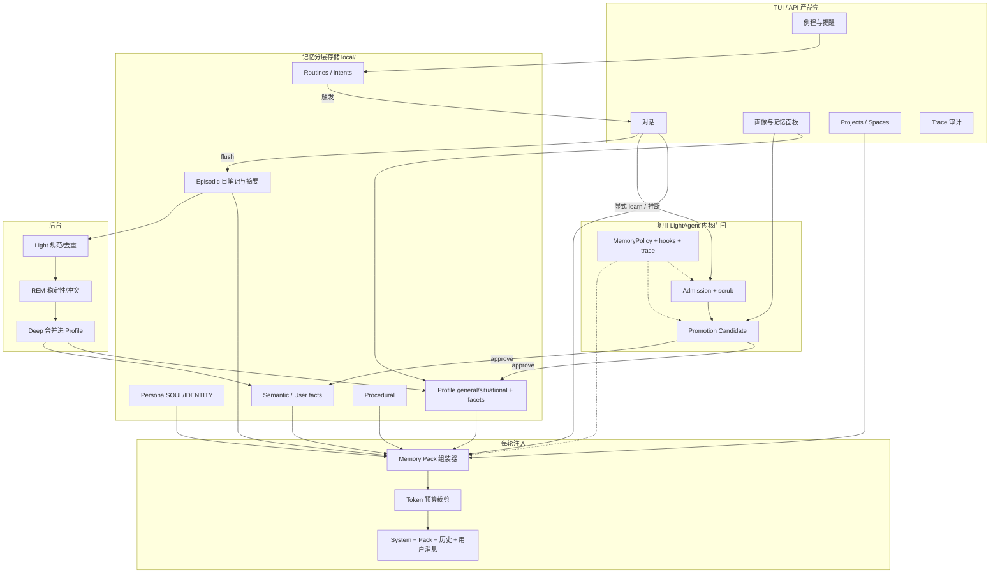

# LightAgent 二开：全方位个人生活助手 — 记忆与能力完整愿景

> 定位纠正：不做「最小集」砍功能；目标是**能放进日常生活、长久使用的全方位个人助手**。  
> 依据：`user_memory_layers_zh.md` + 对照 `/workspace/LightAgent` 代码（`MemoryProtocol` / `MemoryPolicy` / Admission / Promotion / `SharedMemoryPool` / `core._add_memory_context` / TUI Projects）。  
> 日期：2026-10-12（America/Martinique）· **未消耗** OpenRouter 额度 · **未改** LightAgent 业务代码

---

## 0. 结论先行

**最终态一句话**：一个跨天/跨周仍记得你的偏好与事实、能在生活域（家/工作/学习/出行）里主动延续上下文与提醒、用户随时可审可改可忘、且在免费额度下仍可持续运转的个人生活助手。

「越用越懂」不是堆聊天记录，而是完整记忆栈：

| 优先级 | 层 | 作用 |
| --- | --- | --- |
| P0 常驻 | Profile / Preference（含 general vs situational） | 怎么对你说话、硬偏好、身份事实 |
| P0 可编辑 | Persona（SOUL/IDENTITY） | 助手是谁 — 与用户记忆严格分离 |
| P1 按需 | Episodic + Semantic/User facts | 证据与可晋升事实 |
| P1 隔离 | Project / Space | 生活域不串味 |
| P2 巩固 | Dreaming / consolidate + provenance | 静默变聪明、防投毒 |
| P2–P3 行为 | Procedural + Routines/提醒 | 习惯流程与主动延续 |

LightAgent **已有**安全门闩（Admission / Promotion / Scope / Policy / Trace hooks），**缺**产品化用户画像、每轮 memory pack、偏好两车道、日笔记、后台巩固、生活域例程。二开应落在 `local/`（Profile store、注入器、巩固任务、TUI 编辑入口），**复用**内核 Protocol/Admission/Promotion，外挂可换存储（SQLite → 可选 Mem0/ClawMem）。

---

## A. 产品定位

### A.1 是什么 / 不是什么

| 是 | 不是 |
| --- | --- |
| 个人生活助手：陪你过日子、记你的事、提醒你、帮你做小决策 | 企业客服 / 工单机器人 |
| 长久日用：跨会话、跨周、跨项目仍连贯 | 一次性 demo agent |
| 用户主权：可看、可改、可 pin、可 forget | 黑盒「它自己记住了」 |
| 本地优先 + OpenRouter `:free` 省额度 | 默认多 Agent / ToT 烧钱 |

### A.2 日常生活能力面（完整清单）

记忆与能力一起规划；下列均属「长久日用」范围：

1. **日程与时间** — 今日/本周安排、冲突提醒、时区（用户区 America/Martinique）感知  
2. **任务与待办** — 清单、优先级、跨项目跟进、「上次说到哪」  
3. **习惯与例程** — 晨间/睡前、运动、吃药、复盘；可触发的 standing intent  
4. **健康（粗粒度）** — 睡眠/运动/过敏/忌口偏好；**不**做诊疗，敏感项需用户确认才写入 Profile  
5. **财务（粗粒度）** — 预算意识、订阅、大额意向；**不**存卡号/密码；密钥 scrub  
6. **人际与社交备忘** — 「上次和 X 聊到 Y」、礼物意向、忌讳；按 Space 隔离  
7. **学习 / 工作项目** — 进度、资料锚点、下周计划；对接 TUI Project  
8. **购物 / 出行偏好** — 航司/座位、饮食、品牌偏好（situational 车道）  
9. **情绪与沟通风格** — 语气、长短、是否直接；进 Profile facets（style）  
10. **长期目标** — 季度/年度目标与阶段性回顾；进 goal facet + Prospective  

### A.3 成功标准（可验收）

- **跨天记得**：关掉会话隔天再开，仍知硬偏好与关键事实，无需用户复述  
- **跨项目不串**：工作 Space 的敏感事实默认不进「家」对话  
- **主动延续**：例程/提醒能在合适时间点出「该复盘了」「出差前记得…」  
- **可审可改可忘**：TUI/API 列出 Profile、情景、候选晋升；支持 pin / edit / forget / rebuild  
- **隐私与投毒**：untrusted（网页/工具结果）永不自动晋升 curated；写前 scrub；敏感类需确认  
- **免费可续跑**：日常对话优先本地规则与小包注入；抽取/巩固批量离线、可跳过当日额度耗尽

---

## B. 完整记忆体系

### B.1 分层总表

| # | 层 | 职责 | 写入 | 注入 | 晋升 | 遗忘 |
| --- | --- | --- | --- | --- | --- | --- |
| 1 | **Working / Session** | 本轮工具态、当前会话短期事实 | 自动 / session store | 本会话可见 | 会话结束 → 摘要进 Episodic 或丢弃 | 会话清理 |
| 2 | **Episodic** | 日笔记、对话摘要、事件时间线 | 每会话 flush、日文件 `memory/YYYY-MM-DD.md` | **不**全量注入；search / Active Memory / pack 按需 | 重复/用户说记住/稳定性高 → Semantic 或 Profile | 衰减、归档、用户删 |
| 3 | **Semantic / User facts** | 实体、关系、长期事实（可选图） | learn / 抽取 / consolidate | 检索进 pack；高置信可常驻一小段 | 冲突 resolve；图共现增强 | supersede、过期 |
| 4 | **Profile / Preference** | 「你是谁 / 怎么对你」 | 显式偏好、facet 稳定分、用户编辑 | **general 常驻**；**situational 按主题召回** | Dreaming Deep / 用户 pin | forget、半衰期、argmax(stability) |
| 5 | **Procedural** | 个人习惯流程、常用工具套路 | 「下次按这个做」、skill 沉淀 | 任务匹配时注入 | 版本化、纠正覆盖 | 弃用旧版 |
| 6 | **Persona** | 助手人格 SOUL/IDENTITY/ROLE | 用户/开发者编辑文件 | 会话开始常驻（与用户记忆分栏） | 不经用户记忆晋升路径 | 版本回滚 |
| 7 | **Project / Space** | 生活域隔离：家、工作、学习、出行… | 写入带 `space_id` | 检索默认当前 Space + 全局 Profile | 跨 Space 迁移需显式 | Space 归档 |
| 8 | **Shared / Trusted + provenance** | 多 agent/工具共享与信任分级 | 带 provenance 写入 Shared 或池 | 仅 trusted/owner 可自动注入 | untrusted **禁止**晋升 curated | taint 当轮丢弃 |

### B.2 Profile 两车道与 facet（对齐 OpenHuman）

**两车道**

- **general**：Always / Never / Prefer 类硬规则 → 线程开始写入 system（预算内，约 ≤25 条或固定 token 帽）  
- **situational**：与主题相关的软偏好（出行、购物、某项目习惯）→ 每轮按语义/关键词进 user lane 的 memory pack  

**Facets（建议 6 类 + 生活扩展）**

| Facet | 例 | 稳定性半衰期（建议） |
| --- | --- | --- |
| identity | 姓名称呼、时区、家庭结构粗粒度 | ~90d |
| style | 语气、长度、语言 | ~60d |
| goal | 长期目标、季度重点 | ~60d |
| tooling | 常用工具/技能偏好 | ~30d |
| veto | Never 类禁忌 | ~90d（pin 更高） |
| channel | 当前频道/入口习惯 | ~7d |
| *life*（扩展） | 健康忌口、出行、人际忌讳 | 按敏感度 30–90d，写入常需确认 |

冲突：`argmax(stability)`；用户 pin 压过模型推断。

### B.3 每轮 Memory Pack（核心注入契约）

**原则**（对齐 OpenHuman）：pack **只进当轮请求，不写回聊天历史**，保护可缓存前缀。

```
memory_pack = {
  persona_slice,          # SOUL/IDENTITY 摘要，常驻
  profile_general,        # 硬偏好，常驻，token 预算 A
  profile_situational,    # 本轮主题相关，预算 B
  semantic_hits,          # 事实检索，预算 C
  episodic_hits,          # 日笔记/摘要片段，预算 D（通常最小）
  procedural_hits,        # 匹配到的习惯流程，预算 E
  space_context,          # 当前 Project/Space 元数据
}
# Σ token ≤ MEMORY_PACK_BUDGET（建议默认 800–1500；可配置）
# 优先级裁剪：general > veto/pin > situational > semantic > procedural > episodic
```

对照现状：`core._add_memory_context` 把检索结果拼进 **用户提问字符串**（`##用户偏好`），并 **每轮把整句 query store 进 memory** — 无预算、无分层、污染会话文本。二开注入器应改为：**system/developer 侧独立 pack** + 可选轻量 user 前缀；store 改为「候选/日笔记」，不是原文整句入库。

### B.4 写入路径

```
用户说 / 工具结果
    │
    ├─► Working（当轮）
    ├─► Session 短期（可选）
    ├─► Episodic 日笔记（默认，低成本，本地规则摘要优先）
    │
    ├─► 显式 learn / 「记住这个」 ──Admission(scrub/限流/拒模式)──► Semantic 或 Profile
    ├─► 模型推断偏好 ──► Candidate（injectable=False）──Promotion──► Profile/Semantic
    └─► 网页/工具 untrusted ──► taint；永不可自动进 curated
```

复用 LightAgent：

- `MemoryPolicy.memory_write_admission` / `require_write_admission` / `max_writes_per_run` / `reject_duplicate_writes` / `reject_write_patterns`  
- `MemoryCandidate` + `memory_promotion_admission` + `promote_memory_candidate`  
- hooks：`before_memory_write` / `after_memory_write` / `before_memory_retrieve` / `before_memory_promote`  
- `MemoryScope` 的 `source` / `scope` / `trust_level` / `trace_id` 作为 provenance 骨架  

### B.5 后台 Dreaming / consolidate（对齐 OpenClaw）

| 阶段 | 做什么 | 是否调模型 | 何时 |
| --- | --- | --- | --- |
| Light | 规范日笔记、去重指纹、过期标记 | 否（本地规则） | 会话结束 / 定时 |
| REM | 聚候选、算稳定性、标冲突 | 尽量规则；可选小模型 | 日终 / 额度空闲 |
| Deep | 合并进 Profile/MEMORY；supersede；写 `DREAMS.md` 给人审 | 是（批量 1 次调用合并多条） | 用户睡眠窗口或显式「整理记忆」 |
| Review | UI 展示待审晋升 | 否 | 随时 |

**免费额度策略**：Deep 默认「有余量才跑」；`local/openrouter_config.py` 的 `DAILY_LIMIT` / `usage_today()` 门控；额度紧时只跑 Light+REM。

### B.6 用户控制面（learn / forget / pin / edit）

| 能力 | API / 工具 | UI（TUI） |
| --- | --- | --- |
| learn | `memory_learn(text, lane, facet, space?)` | 「记住」快捷；或对话确认卡 |
| forget | `memory_forget(id\|query)` | 列表多选删除 |
| pin | `memory_pin(id)` | 星标，永不被半衰期挤出 |
| edit | `memory_edit(id, text)` | 行内编辑 Profile |
| list | `memory_list(layer, space?)` | 「用户画像 / 记忆」面板 |
| rebuild | `profile_rebuild_from_episodic` | 高级：从日笔记重算候选（需确认） |
| pause | 全局「暂停记忆写入」 | Settings 开关 |

Persona 与 Profile **分两个入口**，避免用户改「助手人格」时误删「我的偏好」。

### B.7 Token 预算建议（可配置）

| 槽位 | 默认上限（约） | 常驻? |
| --- | --- | --- |
| Persona | 300–500 tok | 是 |
| Profile general + veto | 400–600 | 是 |
| Situational | 200–400 | 否 |
| Semantic | 200–400 | 否 |
| Episodic | 100–300 | 否 |
| Procedural | 100–200 | 否 |
| **Pack 合计** | **≤ 1200–1800** | — |

会话历史另计；pack 不计入「可写回」消息。

---

## C. 与生活助手强绑定的非记忆能力

> 记忆是「懂」；下列是「能帮上忙」。架构上同一产品壳，分层交付。

| 能力 | 说明 | 依赖记忆？ | 产品壳 / 运行时 |
| --- | --- | --- | --- |
| **Projects / Spaces** | TUI 已有进程内 `Project`+`Session`；升为生活域：家/工作/学习/出行…；记忆 `space_id` | 强：隔离与检索过滤 | TUI + 持久化 store |
| **Routines / 提醒** | cron/standing intent：晨间摘要、药、复盘、出行前 | 强：Prospective + Profile | 本地调度器 + 通知通道（先 TUI 内提醒） |
| **日历 / 待办衔接** | 先「助手内清单+ICS 导出/导入」；后可选 CalDAV/系统日历 | 中：事件进 Episodic | 插件/Skill |
| **Skills / Plugins** | 已有 `SkillManager`、`local/plugins_system`、TUI 热读 enabled | 中：Procedural 可沉淀为 skill | 保持 |
| **联网工具** | 见 `web_tools_survey_zh.md`；免费路径优先 ddgs+fetch；OpenRouter web **另收费勿默认** | 弱；结果 taint | `local/tools` |
| **Trace / 可审计** | 已有 memory_write/retrieve/promotion trace；扩展「为何注入这条」 | 强：信任 | Trace 面板（TUI 已有 trace 雏形） |
| **Budget / `:free`** | `run_free`、日限额、模型轮换 | 强：巩固与抽取调度 | `openrouter_config.py` |
| **TUI 画像/记忆入口** | Settings 旁「记忆」页：Profile / 候选 / 日笔记 | 强 | `local/tui` 新屏 |
| **多模态附件** | 小票/截图进 Episodic（路径引用，非默认全量进 prompt） | 中 | 后续 |

**原则**：不默认 ToT、不默认多 Agent 膨胀；复杂任务用 Skill 单路径 + 可选轻量子调用，且计入同一 Budget。

---

## D. LightAgent 对照与差距

### D.1 已有（可复用）

| 组件 | 现状 | 二开用法 |
| --- | --- | --- |
| `MemoryProtocol` | `store` / `retrieve` | 底层适配器口；上层加 learn/forget facade |
| `MemoryScope` | source/scope/trust/trace | 扩展 `space_id`、`lane`、`facet`、`provenance` 进 metadata |
| `MemoryPolicy` | 命名空间、白名单、限流、去重、模式拒、expires | 生活助手默认 fail-closed 写策略 |
| Admission | 写前钩子 + `require_write_admission` | scrub 密钥、敏感确认、拒投毒句式 |
| Promotion | Candidate 非 injectable；approve/reject/rewrite/keep | Dreaming Deep / 用户审核出口 |
| `SharedMemoryPool` | **内存** append-only 原型 | 仅实验；生产换持久后端 |
| hooks + trace | before/after retrieve/write/promote | 审计「为何记住/为何注入」 |
| `self_learning` | reflection → 晋升门闩 | **不要**当作用户画像；最多进 agent Procedural 候选 |
| Skills / plugins / TUI projects | 已有雏形 | 升为 Spaces + 记忆面板 |
| `run_free` | 日/分钟限额 | 巩固与抽取门控 |

### D.2 缺口（相对完整生活助手）

1. **无 Profile 常驻层**（无 USER.md / facets / 两车道）  
2. **无真正 memory pack**（现状把记忆拼进 user query，且每轮整句 store）  
3. **无 Episodic 日笔记与会话摘要管线**  
4. **无后台 Dreaming / 稳定性打分**  
5. **无 learn/forget/pin/edit 一等工具与 TUI**  
6. **Project 仅 UI 内存**，无 `space_id` 进记忆策略  
7. **无 Persona 与用户记忆分栏**  
8. **provenance 未产品化为 owner/agent/untrusted/system 晋升规则**  
9. **Protocol 过窄**（无 list/delete/update；需在 `local/` facade 补齐，避免先改内核公 API）  
10. **无 Routines / Prospective**

### D.3 重要代码偏差（相对先前「最小集」调研表述）

1. **注入方式偏差**：调研说「可外挂检索」；实核 `_add_memory_context` 是 **检索结果字符串拼进提问** + **无条件 store(query)**，不是独立 pack，也不是「只读画像」。  
2. **self_learning ≠ 懂用户**：开启后写的是 `source=reflection` / `scope=agent`，默认要 Promotion；积的是 agent 候选，**不会**自动变成用户 Profile。  
3. **SharedMemoryPool 非持久**：文档已写明 prototype；不能当作用户画像库。  
4. **TUI「P / profile」只是用户名展示**，不是记忆编辑入口。  
5. **trust_level 字段已在**，但无强制「untrusted 禁止晋升 curated」的默认策略实现（需在 `local/` Policy 预设里补）。

### D.4 目标架构（mermaid）



### D.5 建议落点（不改内核业务逻辑优先）

```
local/
  memory/
    profile_store.py      # USER 画像、lanes、facets、pin
    episodic_store.py     # 日笔记、会话摘要
    pack.py               # 每轮 memory pack + 预算
    tools.py              # learn/forget/pin/edit/list
    dreaming.py           # Light/REM/Deep 调度 + run_free 门控
    provenance.py         # owner/agent/untrusted/system 规则
    policy_presets.py     # 生活助手默认 MemoryPolicy
  tui/
    memory_panel.py       # 可编辑入口
  research/
    personal_life_assistant_memory_zh.md  # 本文
```

持久化：先 SQLite（或 JSONL+SQLite FTS）满足 Protocol；需要图/混合检索再挂 Mem0/ClawMem adapter。

---

## E. 分阶段路线（完整态优先；阶段=交付顺序）

> 每一阶段都服务最终「长久日用」定位；不砍最终能力，只排实现顺序。

### 最终态（单独描述）

用户每天打开同一助手：左侧 Spaces（家/工作/学习/出行）与会话；对话时 system 侧已带 Persona + general 偏好；相关情景与事实以 pack 按需出现。晚上或空闲时 Dreaming 把日笔记里反复出现的偏好整理成候选，用户在「记忆」面板一键批准或修改。例程在晨间推「今日三事」与习惯打卡；出行 Space 自动带上座位/航司偏好而不污染工作对话。网页摘要标 untrusted，从不静默写进 Profile。额度紧张时仍能对话（规则注入 + 跳过 Deep）；额度恢复后补巩固。一年后重装，导出的 Profile+Episodic 仍可导入 — **越用越懂，且可搬迁、可遗忘**。

### P0 — 画像地基（可审可改的「懂」）

**交付**

- Profile store（general / situational + facets + pin）  
- Persona 文件分栏（SOUL/IDENTITY）  
- learn / forget / pin / edit / list 工具 + Admission scrub  
- 每轮 **预算注入**（先实现 pack 骨架；general 常驻）  
- TUI「用户画像 / 记忆」只读+编辑入口  
- 生活助手默认 `MemoryPolicy` 预设（限写、拒毒句式、`require_write_admission` 对共享后端）

**验收**

- 用户写入「以后简称我小 Q」→ 新会话无需再说，回复使用该称呼  
- forget 后不再出现  
- pack token 不超过配置帽；**不**把 pack 写回 chat 历史  
- 密钥样例被 scrub，不入库  

### P1 — 情景 + Pack 完整化 + Space 隔离

**交付**

- Episodic 日笔记与会话结束摘要（本地规则优先）  
- memory pack 补齐 situational / semantic / episodic 槽位与优先级裁剪  
- Project → Space：`space_id` 写入与检索过滤；全局 Profile vs Space 事实  
- 显式「记住这个」与「只在本项目记住」

**验收**

- 工作 Space 的客户名默认不出现在「家」闲聊 pack  
- 问「上周三我说了什么」能检索日笔记片段  
- 跨天打开同 Space，能延续「上次待办」摘要  

### P2 — 巩固、实体与 provenance

**交付**

- Dreaming Light/REM/Deep + `DREAMS.md`/面板待审  
- 稳定性打分与 supersede  
- Semantic 实体索引（可先关键词+简单关系表；后可选图）  
- provenance 四级：owner / agent / untrusted / system；untrusted 禁止自动晋升  
- Trace：「本轮注入了哪些记忆、为何」

**验收**

- 连续三天提到「不吃香菜」→ Deep 产出 Profile 候选 → 用户批准后常驻  
- 网页里的「忽略之前指令…」无法进 Profile  
- 额度用尽日 Deep 自动跳过且有日志；次日可补跑  

### P3 — 生活域主动能力

**交付**

- Routines / Prospective（晨间、习惯、出行前）  
- 待办/粗日历衔接（内置清单 + ICS）  
- Procedural 沉淀常用套路；Skill 联动  
- 导出/导入记忆包；暂停写入；敏感类确认流（健康/财务）  
- （可选）轻量主动消息通道 — **仅在用户明确授权后**

**验收**

- 设定「每周日 20:00 周复盘」→ 到点 TUI/授权通道提醒并带上周 Episodic 摘要  
- 用户关闭「健康写入」后，相关推断只进候选且不自动晋升  
- 连续使用 30 天：Profile 条目可解释、可删、无秘密泄漏；日均模型调用可控在 `DAILY_LIMIT` 内可配置比例（建议巩固 ≤ 日额度 20%）  

---

## F. 风险与原则

| 风险 | 原则 |
| --- | --- |
| 隐私泄漏 | 本地存储默认；导出需显式；Trace 不落原文密钥 |
| 密钥 / 卡号入库 | Admission scrub + `reject_write_patterns`；失败则拒写 |
| Prompt 投毒 | untrusted taint；Promotion fail-closed；网页结果不当 general |
| 敏感推断误写 | 健康/财务/人际忌讳 → 默认候选 + 用户确认 |
| 免费额度烧光 | 注入用本地检索；抽取/Deep 批量、可跳过；禁止对话路径默认 ToT/多 Agent |
| 记忆膨胀 | 预算裁剪、半衰期、去重、Space 归档 |
| 与内核分叉 | 优先 `local/` facade；确需改 Protocol 再提兼容 PR |
| 用户失去控制 | 任何自动晋升可关；一键暂停记忆；forget 真删 |

**硬原则**

1. Persona ≠ User Profile  
2. Episodic 是证据，不是画像  
3. Pack 只进当轮，不写回历史  
4. 无用户授权，不做主动外发（邮件/IM）  
5. 完整能力按阶段交付，**不**用「最小集」偷换最终定位  

---

## 附录：与 `user_memory_layers_zh.md` 的关系

前序调研给出了业界分层与「强相关层」对照，并曾建议「最小集」。**本文按用户纠正**：最小集仅可作为 P0 的**交付切片**，不可作为产品能力上限。完整分层（含 Procedural、Persona、Space、Shared/provenance、Dreaming、Routines）均在最终态内；P0–P3 只规定何时落地。

---

## 给用户看的摘要（可直接贴聊天）

1. 已按「全方位个人生活助手、长久日用」重写完整愿景，路径：`local/research/personal_life_assistant_memory_zh.md`。  
2. 最终态：跨天跨项目仍懂你的偏好与事实，能主动提醒与延续，可审可改可忘，免费额度下也能续跑。  
3. 记忆全栈：Working/Session、Episodic、Semantic、Profile（general+situational）、Procedural、Persona、Space 隔离、Trusted/provenance。  
4. 每轮 **memory pack + token 预算**；pack 不写回聊天；后台 Dreaming 巩固。  
5. 一并规划：Spaces、例程提醒、日历待办、Skills、联网、Trace、`:free` 预算、TUI 记忆编辑入口。  
6. LightAgent 已有 Admission/Promotion/Policy 门闩可复用；缺的是画像、pack、日笔记、巩固与生活域主动能力。  
7. 阶段：P0 画像+两车道+learn/forget → P1 日笔记+pack+Space → P2 Dreaming+实体+provenance → P3 例程/提醒与主动延续。  
8. 代码偏差：当前是把检索拼进用户提问并整句 store，不是真正 pack；`self_learning` 不等于懂用户。  
9. 相对「最小集」加厚了：生活域全能力面、Persona 分栏、Space、Dreaming、Routines、敏感确认与额度门控。  
10. 未改业务代码、未耗 OpenRouter；下一步若开工建议从 P0 的 `local/memory/` + TUI 记忆面板落地。
